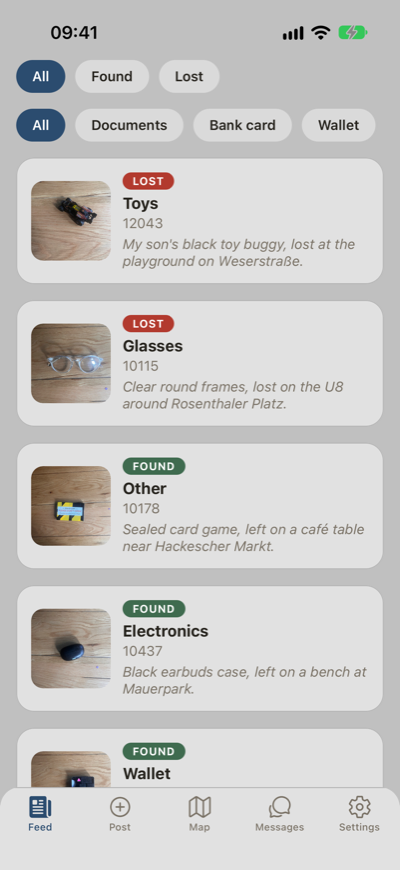
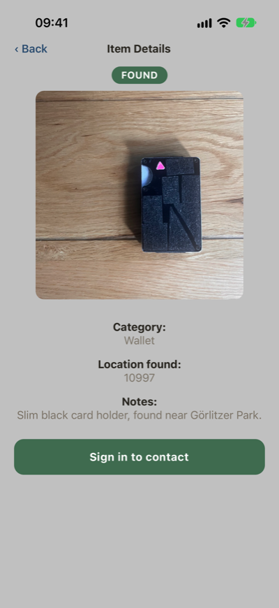
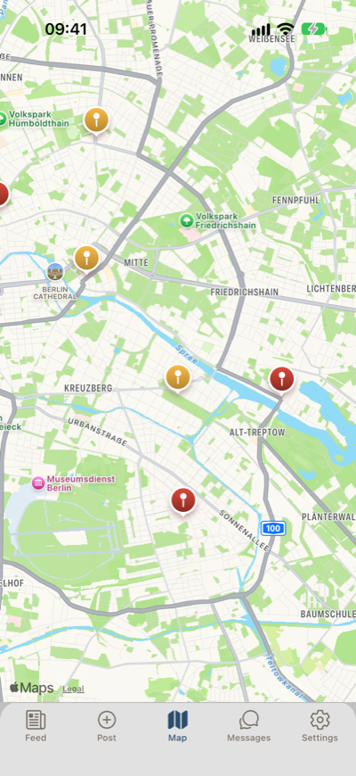
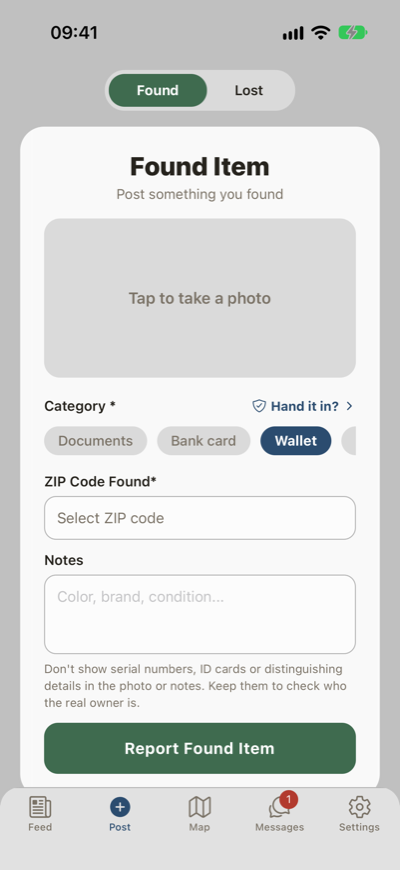
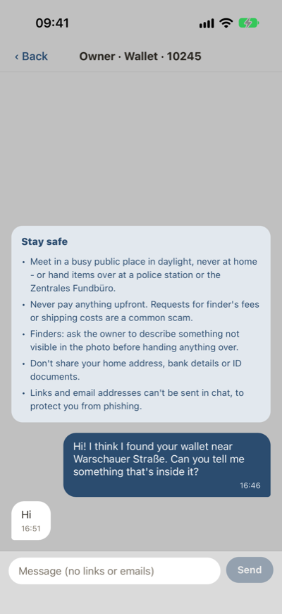
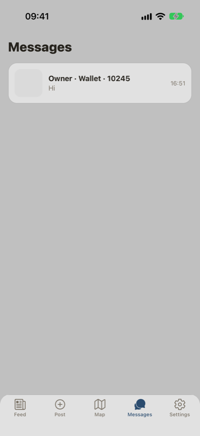
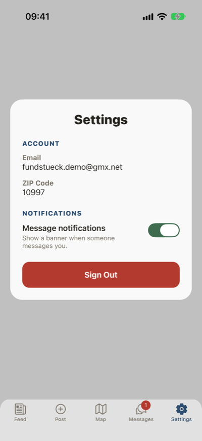

# Fundstück - Lost & Found App

**Work in Progress 🚧**

Fundstück is a mobile app for reporting and finding lost and found items in Berlin. Users can post items they've found, report items they've lost, and browse items in a feed or on a map.

## Screenshots

<table>
  <tr>
    <td align="center"><br><sub>Feed</sub></td>
    <td align="center"><br><sub>Item details</sub></td>
    <td align="center"><br><sub>Map</sub></td>
    <td align="center"><br><sub>Post a found item</sub></td>
  </tr>
  <tr>
    <td align="center"><br><sub>Chat</sub></td>
    <td align="center"><br><sub>Messages</sub></td>
    <td align="center"><br><sub>Settings</sub></td>
  </tr>
</table>

## Features

- Post found items with a camera photo, category, ZIP code, and notes
- Post lost items with an optional photo, category, ZIP code, and description
- Browse found and lost items in a live feed, filterable by type and category
- View items on a map, grouped by ZIP code
- User accounts with email, password, and ZIP code, with email confirmation
- Anyone can browse; posting requires an account
- Private chat between finder and owner, with safety tips and links/emails blocked
- Unread badge and in-app message banners, switchable in Settings
- Mark items as returned (planned)
- Notifications for items in your area (planned)

## Tech Stack

- **App:** React Native 0.86 with Expo SDK 57, TypeScript, React Navigation 7
- **Backend:** Supabase (Postgres, Auth, Realtime, Storage) with Row Level Security
- **Maps & geocoding:** react-native-maps, OpenStreetMap Nominatim API
- **Images:** expo-image-picker, uploaded to Supabase Storage
- **Email confirmation page:** static page in `docs/`, served by GitHub Pages

## Getting Started

### 1. Install

```bash
git clone https://github.com/AntonisKol/Fundst-ck.git
cd Fundst-ck
npm install
```

### 2. Configure Supabase

Create a `.env` file in the project root (it's gitignored - never commit it):

```
SUPABASE_URL=https://<project-ref>.supabase.co
SUPABASE_ANON_KEY=<anon / public key>
```

Find both under **Project Settings → API Keys** in the Supabase dashboard. Use the anon/public key, never the `service_role` key.

For a fresh Supabase project, run these in the SQL Editor, in order:

1. `supabase/001_found_items.sql`
2. `supabase/002_found_items_add_coordinates.sql` (a no-op on fresh projects; for older ones)
3. `supabase/003_lost_items.sql`
4. `supabase/004_storage_setup.sql`
5. `supabase/005_auth_setup.sql`
6. `supabase/006_chat.sql`
7. `supabase/007_chat_safety.sql` - without it, only the app enforces the chat rules

New SQL files continue the numbering. If you save them as queries in the Supabase SQL Editor, use the same names (e.g. "006 chat") so the two stay easy to match. `006_chat.sql` and `007_chat_safety.sql` are safe to re-run. When a pull request changes one of them, re-run it after merging.

Under **Authentication → URL Configuration**, set the Site URL to the confirmation page: `https://antoniskol.github.io/Fundst-ck/confirmed/`.

### 3. Run

```bash
npx expo start --clear
```

Scan the QR code with Expo Go (SDK 57). Use `--clear` whenever `.env` changes - its values are compiled into the bundle.

## Regenerating the screenshots

The screenshots above are taken automatically with [Maestro](https://maestro.mobile.dev) on the iOS Simulator (`.maestro/screenshots.yaml`), signed in as a demo account:

```bash
npx expo start --port 8082   # serve the app; open it once in the simulator's Expo Go
./scripts/screenshots.sh      # runs the flow and updates docs/screenshots/
```

The demo login lives outside the repo in `~/fundstueck-demo.txt` (`EMAIL=` and `PASSWORD=` lines).
