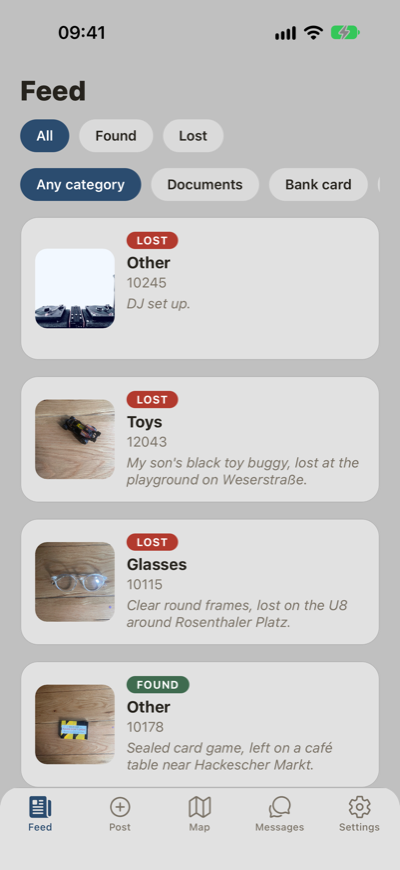
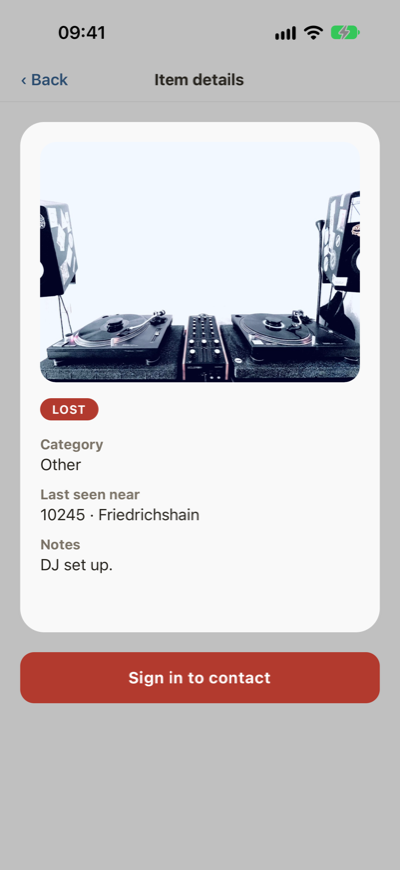
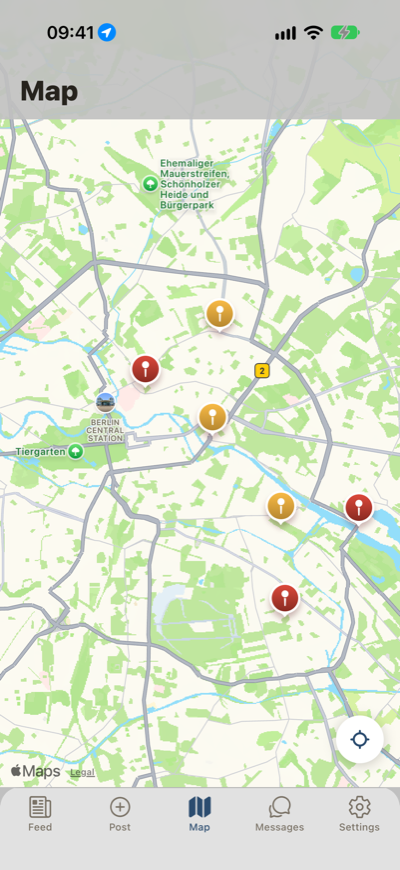
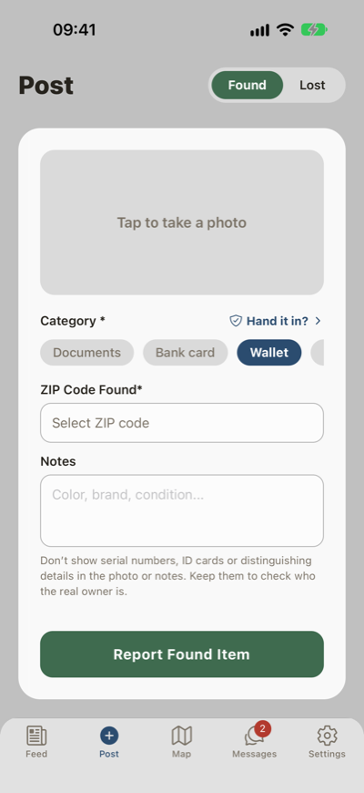
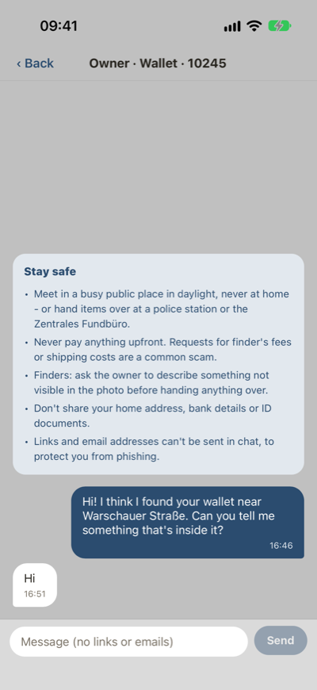
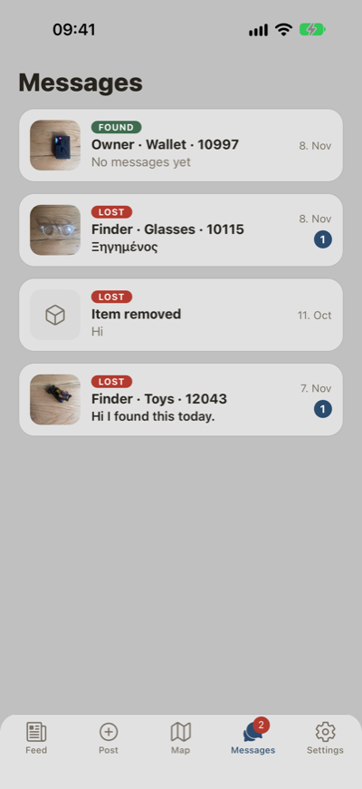
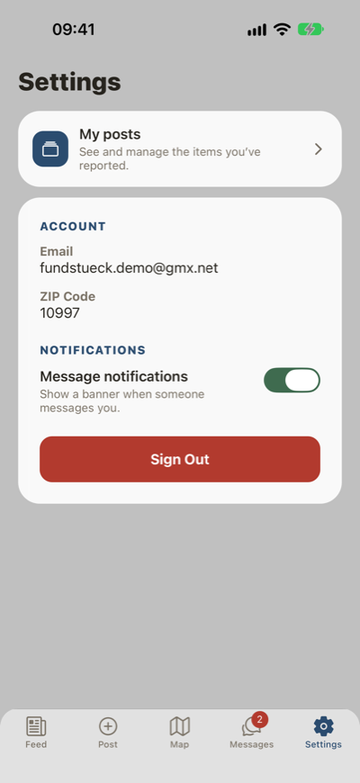

# Fundstück - Lost & Found App

**Work in Progress 🚧**

Fundstück is a mobile app for reporting and finding lost and found items in Berlin. Users can post items they've found, report items they've lost, and browse items in a feed or on a map.

## Screenshots

<table>
  <tr>
    <td align="center"><br><sub>Feed</sub></td>
    <td align="center"><br><sub>Item details</sub></td>
    <td align="center"><br><sub>Map</sub></td>
    <td align="center"><br><sub>Post a found item</sub></td>
  </tr>
  <tr>
    <td align="center"><br><sub>Chat</sub></td>
    <td align="center"><br><sub>Messages</sub></td>
    <td align="center"><br><sub>Settings</sub></td>
  </tr>
</table>

## Features

- Post found items with a camera photo, category, ZIP code, and notes
- Post lost items with an optional photo, category, ZIP code, and description
- Browse found and lost items in a live feed, filterable by type and category
- View items on a map, grouped by ZIP code
- User accounts with email, password, and ZIP code, with email confirmation
- Anyone can browse; posting requires an account
- Private chat between finder and owner, with safety tips and links/emails blocked
- Unread badge and in-app message banners, switchable in Settings
- Mark your own posts as returned or delete them; returned posts leave the Feed and Map
- Report someone or a specific message from a chat; block someone, so neither of you can message the other
- Notifications for items in your area (planned)

## Tech Stack

- **App:** React Native 0.86 with Expo SDK 57, TypeScript, React Navigation 7
- **Backend:** Supabase (Postgres, Auth, Realtime, Storage) with Row Level Security
- **Maps & geocoding:** react-native-maps, OpenStreetMap Nominatim API
- **Images:** expo-image-picker, uploaded to Supabase Storage
- **Email confirmation page:** static page in `docs/`, served by GitHub Pages

## Project Structure

```
src/
  App.tsx           app entry: providers and navigation
  components/       shared UI (item card, item form, report sheet, top bar, ...)
  constants/        categories, theme, chat safety rules, Berlin ZIP codes
  context/          React contexts: auth session, unread messages
  hooks/            shared hooks: item form state, open items loader
  navigation/       root stack and bottom tab navigator
  screens/          one folder per screen (Feed, Map, Post, Chat, Account, ...)
  supabase/         Supabase client
  types/            database rows, item and navigation types
  utils/            helpers (chat, geocoding, location, notifications, storage) and their tests
supabase/           numbered SQL files: tables, row level security, triggers
scripts/
  db-checks/        checks the database rules against the real Supabase project
  screenshots.sh    regenerates the README screenshots
plugins/            Expo config plugin (iOS scene life cycle)
types/              type declarations for .env values
.maestro/           Maestro flow that takes the screenshots
.github/
  workflows/        CI, project board automation, on-demand Claude review
  pull_request_template.md
docs/               email confirmation page (GitHub Pages) and screenshots
```

Tests sit next to the code they test (`*.test.ts`) and run with Vitest.

## Getting Started

### 1. Install

```bash
git clone https://github.com/AntonisKol/Fundst-ck.git
cd Fundst-ck
npm install
```

### 2. Configure Supabase

Create a `.env` file in the project root (it's gitignored - never commit it):

```
SUPABASE_URL=https://<project-ref>.supabase.co
SUPABASE_ANON_KEY=<anon / public key>
```

Find both under **Project Settings → API Keys** in the Supabase dashboard. Use the anon/public key, never the `service_role` key.

For a fresh Supabase project, run these in the SQL Editor, in order:

1. `supabase/001_found_items.sql`
2. `supabase/002_found_items_add_coordinates.sql` (a no-op on fresh projects; for older ones)
3. `supabase/003_lost_items.sql`
4. `supabase/004_storage_setup.sql`
5. `supabase/005_auth_setup.sql`
6. `supabase/006_chat.sql`
7. `supabase/007_chat_safety.sql` - without it, only the app enforces the chat rules
8. `supabase/008_post_status.sql` - open/returned status; posters can edit and delete their own posts
9. `supabase/009_reports_blocks.sql` - tables for reporting and blocking users
10. `supabase/010_block_messages.sql` - refuses messages between blocked users

New SQL files continue the numbering. If you save them as queries in the Supabase SQL Editor, use the same names (e.g. "006 chat") so the two stay easy to match. `006_chat.sql` to `010_block_messages.sql` are safe to re-run. When a pull request changes one of them, re-run it after merging.

Under **Authentication → URL Configuration**, set the Site URL to the confirmation page: `https://antoniskol.github.io/Fundst-ck/confirmed/`.

### 3. Run

```bash
npx expo start --clear
```

Scan the QR code with Expo Go (SDK 57). Use `--clear` whenever `.env` changes - its values are compiled into the bundle.

### 4. Check

```bash
npm run lint
npm run typecheck
npm test
```

`npm test` runs both test suites; each also runs on its own:

- `npm run test:unit` - Vitest unit tests for logic (`src/**/*.test.ts`)
- `npm run test:ui` - Jest + React Native Testing Library screen tests (`src/**/*.ui.test.tsx`)

### 5. Check the database rules

Who may edit, report, block or message whom is enforced by Supabase (row level security, grants and triggers), not by the app. Unit tests can't see those rules, so `scripts/db-checks/` tests them against the real database, signed in and signed out, just like the app talks to it:

```bash
npm run db-checks
```

| Script | Checks |
| --- | --- |
| `008-post-status.mjs` | Only the poster can mark a post returned, reopen or delete it; nobody can change `user_id` or `returned_at` |
| `009-reports-blocks.mjs` | You can only report or block people you chat with, as yourself; reports can't be edited or withdrawn |
| `010-block-messages.mjs` | No messages can be sent across a block, and the error text is neutral |

**When:** after running or changing any SQL file in `supabase/`, and before merging a PR that touches the database rules. A failing check exits with code 1.

**What they need:**

- `.env` with the Supabase URL and anon key (never the service role key).
- A demo account that has at least one conversation. Its login stays outside the repo, as `DEMO_EMAIL` and `DEMO_PASSWORD`, or in `~/fundstueck-demo.txt` with `EMAIL=` and `PASSWORD=` lines (`DEMO_CREDENTIALS` points to another file).

**What they change:** only the demo account's own data. 008 works on a temporary post that it deletes; 009 and 010 block the demo account's first chat partner and always unblock again. Reports can't be withdrawn, so 009 leaves one report against that partner (note `db-check 009 - safe to delete`), and later runs see it as "already reported". Deleting someone else's post isn't tested, because if that rule were broken the check would really delete it.

## Workflow

Every change starts as a GitHub issue and goes through a pull request. Nobody commits to `main` directly.

**1. Issue.** Each task is an issue on the [Fundstück project board](https://github.com/users/AntonisKol/projects/1), which has the columns Todo → In progress → In review → Done → Released.

**2. Branch.** Name the branch `<type>/<issue>-<slug>`, for example `fix/69-ios-scene-lifecycle`. Types in use: `feature`, `fix`, `chore`, `ci`, `docs`, `test`, `refactor`.

**3. Pull request.** Open a PR against `main`. The description follows [the PR template](.github/pull_request_template.md):

- `Closes #N` to link the issue
- What & why
- Acceptance criteria, each one checkable ("met" or "not met")
- Out of scope
- How to test

**4. Checks.** [CI](.github/workflows/ci-cd.yml) runs on every PR: `npm ci`, typecheck, `expo-doctor`, lint and tests. It must pass before merging.

**5. Review.** GitHub Copilot reviews each PR automatically. Cursor and Claude review on request, against the acceptance criteria, following [REVIEW.md](REVIEW.md). Comment `@claude review` on the PR to start the [Claude review](.github/workflows/claude-review.yml). The owner reviews last and merges.

**6. Merge.** PRs are squash-merged, so each PR becomes one commit on `main`. The branch is deleted after merging.

**Board automation.** [project-status.yml](.github/workflows/project-status.yml) moves the issue's card for you. It finds the issue from the number in the branch name and from `Closes #N` in the PR.

| Event | Card moves to |
| --- | --- |
| Branch pushed | In progress |
| PR opened | In review |
| PR merged | Done |

A PR that links no issue gets a card of its own. A PR closed without merging leaves the card where it is. Released is set by hand.

**Rules on `main`:** changes only through a pull request, no force pushes and no deleting the branch. Force pushes are blocked on every branch.

## Reviewing reports

Reports stay anonymous in the app, so moderation happens in the Supabase **SQL Editor**, which can read everything. These queries show private emails and messages: use them only to review a report, and never tell someone who reported them.

**Recent reports:**

```sql
select r.created_at, r.reason, r.note,
       reporter.email as reporter,
       reported.email as reported,
       m.body as quoted_message
from public.reports r
join auth.users reported on reported.id = r.reported_user_id
left join auth.users reporter on reporter.id = r.reporter_id
left join public.messages m on m.id = r.message_id
order by r.created_at desc
limit 50;
```

**Who gets reported most**, counting different people so one person can't inflate the number:

```sql
select reported.email, count(distinct r.reporter_id) as reporters, count(*) as reports
from public.reports r
join auth.users reported on reported.id = r.reported_user_id
group by reported.email
order by reporters desc, reports desc;
```

**Ban a user.** This stops them signing in and removes their sessions:

```sql
update auth.users set banned_until = now() + interval '100 years' where email = 'user@example.com';
delete from auth.sessions where user_id = (select id from auth.users where email = 'user@example.com');
```

A ban isn't instant: a token they already hold can keep working until it expires, about an hour by default. To also stop their messages straight away, have the people they're contacting block them.

**Lift a ban:**

```sql
update auth.users set banned_until = null where email = 'user@example.com';
```

Banning doesn't remove their posts. To remove a post, delete its row from `found_items` or `lost_items` in the Table Editor.

## Regenerating the screenshots

The screenshots above are taken automatically with [Maestro](https://maestro.mobile.dev) on the iOS Simulator (`.maestro/screenshots.yaml`), signed in as a demo account:

```bash
npx expo start --port 8082   # serve the app; open it once in the simulator's Expo Go
./scripts/screenshots.sh      # runs the flow and updates docs/screenshots/
```

The demo login lives outside the repo in `~/fundstueck-demo.txt` (`EMAIL=` and `PASSWORD=` lines).
